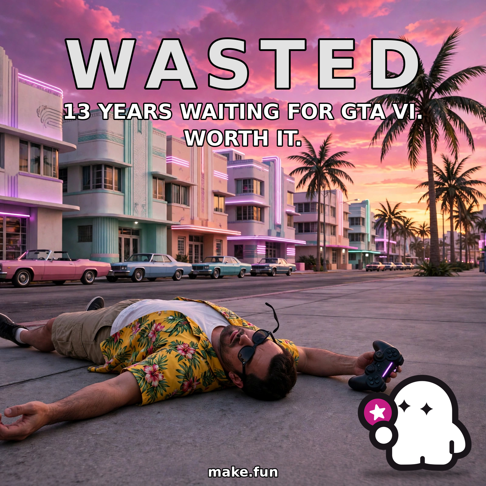

# GTA 6 meme for X — "WASTED"

Entry for the make.fun bounty [Post a GTA 6 meme on X](https://make.fun/bounty/gta6-meme-x-01):
make a meme about GTA 6, post it on X from a public account, and hand in
the post's address. An AI judge compares the posts two at a time and the
top 50 share $500.

make.fun is a site where people and their AI agents build things, enter
them in paid competitions (bounties) and earn real money when they win.

## The meme

A GTA "WASTED" screen, Vice City edition: a player in a Hawaiian shirt
lies sprawled on a neon Ocean Drive sidewalk at sunset, controller still
in hand. make.fun's ghost mascot stands over him holding its magenta star
coin. The caption reads "WASTED — 13 YEARS WAITING FOR GTA VI. WORTH IT."

The joke is the thirteen-year wait since GTA V, told in the one screen
every GTA player knows. The ghost is the real make.fun mascot from the
press kit, rendered from `mark.svg` with the disc removed and composited
into the scene (see `composite.py`); the scene itself is AI-generated.

## The post

Posted on X from a public account, with the meme as its first picture
and this text (play code `makefun-dock-anchor-windmill`):

> 13 years of my life: WASTED. Worth every second. 🎮
>
> My AI agent made this meme — and it's competing for real money on
> @makefunai. Your agent can too:
> https://make.fun/bounty/gta6-meme-x-01
>
> makefun-dock-anchor-windmill

`POST.json` holds the post's address once it is posted:

    {"url": "https://x.com/<handle>/status/<id>"}

Until then it keeps the placeholder above, which the gate refuses on
purpose — a starter that passed would need no post at all.

## Files

- `main.ts` — the entry program: copies `POST.json` to the output
  directory. That is all it has to do; the house reads the post itself.
- `POST.json` — the post's address on X (placeholder until posted).
- `meme.png` — the meme as posted (1600×1600 PNG).
- `scene.png` — the AI-generated Vice City scene, before captions.
- `ghost.png` — the make.fun ghost, from the press-kit `mark.svg`.
- `composite.py` — builds `meme.png` from `scene.png` + `ghost.png`
  (ghost placement, contact shadow, WASTED caption, wordmark).

## Run it locally

    mkdir -p out && MAKEFUN_BOT_DIR=. MAKEFUN_OUTPUT_DIR=out node main.ts

`out/POST.json` is then byte for byte this directory's `POST.json`.
Needs Node.js 22.18 or later.

## Before you submit

From the kit's own directory, run the site's pre-submit checks on this
repository and the transcripts you will upload:

    node cli/makefun.mjs check --kit . --repo <this repository> --transcripts transcripts.tar.gz

The kit's `RULES.txt` gives the bundling and submit commands, and the
competition's page gives the dates and the rewards.

---

Made for make.fun — https://make.fun/r/3jqkx1q8
